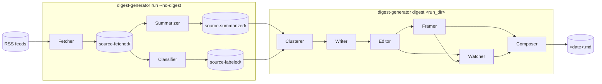

# Usage

This guide covers the command-line interface, the programmatic API, and the output layout.

## How It Works



`digest-generator run` does both halves end to end, writing the per-stage caches and the final Markdown digest into one run directory. You can also run the halves separately: `run --no-digest` builds the corpus and stops, and `digest <run_dir>` turns an existing corpus into a digest. Each stage caches its output in the run directory, so re-running a stage against the same directory skips work that is already done. [Caching and regeneration](#caching-and-regeneration) covers resuming a run and regenerating after a settings change.

## CLI

Installed with `uv tool install digest-generator` (or `pipx`), the `digest-generator` command is on your `PATH`. In a clone set up with `uv sync --extra dev`, prefix each command with `uv run`. The examples below use the bare command:

```bash
digest-generator --help
```

### Feed configuration

The tool ships with no feeds; you supply them in a `feeds.yaml`. Run [`digest-generator init`](#init-write-a-starter-feedsyaml) to write a starter, or copy [`feeds.example.yaml`](../feeds.example.yaml) yourself. Every command that touches feeds (`run`, `fetch`, `feeds`) resolves the file in this order:

1. `--feeds <file>` (or the `FEEDS_FILE` env var)
2. `<config-dir>/feeds.yaml`, where the config dir comes from `--config` (or `DIGEST_CONFIG`)
3. `./digest-generator/feeds.yaml` (project-local)
4. `~/.config/digest-generator/feeds.yaml` (user-level)

The file defines your own `categories:` (the digest sections, each an `id` + `title`, in section order) and a `feeds:` list where each feed's `category` matches one of those ids. Category ids and feed names must be unique. Categories are user-defined, so the section taxonomy is whatever you put in the file, and the `-c` / `--content-type` filters take these category ids. A missing or invalid file produces an actionable error pointing back at the example.

### Prompt overrides

Every LLM stage loads a Markdown prompt template. The bundled templates are generic and topic-neutral, so the tool runs out of the box on any subject. To tune the voice for your topic, drop a `<name>.md` file into a prompts directory; templates you don't override fall back to the bundled baseline. The loader checks, in order:

1. `PROMPTS_DIR`
2. `<DIGEST_CONFIG>/prompts/` (the `DIGEST_CONFIG` env var only; the `--config` flag selects the feeds file, and prompts do not follow it)
3. `./digest-generator/prompts/` (project-local)
4. `~/.config/digest-generator/prompts/` (user-level)

The template names are `section_system`, `section_merge_system`, `editorial_pass_system`, `intro_system`, `title_system`, `watch_system`, `cluster_system`, and `article_summary_system`. Templates may reference the shared anti-cliché catalog via `{{style:...}}` placeholders, which are expanded on whichever template is used.

### `init`: Write a Starter feeds.yaml

Writes the starter feeds config to `~/.config/digest-generator/feeds.yaml`, or to the location the flags name. It refuses to overwrite an existing file unless you pass `--force`.

```bash
# Default location
digest-generator init

# Project-local config, picked up by discovery from this directory
digest-generator init --config ./digest-generator
```

| Option | Description | Default |
|--------|-------------|---------|
| `--config` | Config directory to write `feeds.yaml` into | none |
| `--feeds` | Exact path to write the `feeds.yaml` to (takes precedence over `--config`) | none |
| `--force` | Overwrite an existing `feeds.yaml` | false |

### `run`: Full Pipeline

Fetch articles, generate summaries, classify topics, and produce a digest. Each invocation creates a new run directory under the output directory.

```bash
# Default: all feeds, 7 days back, with digest
digest-generator run

# AI feeds only, 1 day back, skip the digest
digest-generator run -c ai -d 1 --no-digest

# Build the corpus, then generate the digest separately
digest-generator run -c ai --no-digest
digest-generator digest output/2026-03-15-143022-a3f1

# Specific feeds by name
digest-generator run -f openai-news -f github-blog

# Date range instead of days back
digest-generator run --since 2026-03-01 --until 2026-03-15 -c ai
```

| Option | Short | Description | Default |
|--------|-------|-------------|---------|
| `--days` | `-d` | Days back to fetch | `DAYS_BACK` env / 7 |
| `--since` | | Start date, YYYY-MM-DD (mutually exclusive with `--days`) | none |
| `--until` | | End date inclusive, YYYY-MM-DD (mutually exclusive with `--days`) | now |
| `--limit` | `-l` | Max entries per feed | none (all) |
| `--content-type` | `-c` | Filter by category id (repeatable) | all |
| `--feed` | `-f` | Filter by feed name (repeatable) | all |
| `--feeds` | | Path to a `feeds.yaml` file (overrides discovery) | `FEEDS_FILE` env / discovery |
| `--config` | | Config directory holding `feeds.yaml` | `DIGEST_CONFIG` env / discovery |
| `--output-dir` | `-o` | Parent directory for the new run directory | `OUTPUT_DIR` env / `output` |
| `--device` | | Compute device (`cpu`, `cuda`, `mps`) | `DEVICE` env / `cpu` |
| `--no-digest` | | Skip digest generation | false |
| `--audio` | | Render the digest to an Opus audio file after generation (requires the digest stage; rejects `--no-digest`) | false |

Digest model and sampling overrides live on [`digest`](#digest-run_dir-generate-a-digest), which reuses the cached corpus.

### `fetch`: Fetch Articles Only

Fetch articles for the selected feeds into a new run directory and print its path on stdout. The other per-stage commands take that path as their argument, so the four can be chained in a shell:

```bash
RUN_DIR=$(digest-generator fetch -c ai)
digest-generator summarize "$RUN_DIR"
digest-generator label "$RUN_DIR"
digest-generator digest "$RUN_DIR"
```

`fetch` takes the selection options of `run` (`--days`, `--since`, `--until`, `--limit`, `--content-type`, `--feed`, `--feeds`, `--config`, `--output-dir`), without `--device`, `--no-digest`, or `--audio`.

### `summarize` and `label`: Build the Corpus in an Existing Run

Both take a positional `<run_dir>`, read its `source-fetched/`, and skip feeds whose output already exists (delete the file to force a rerun). `summarize` runs the LLM summarizer into `source-summarized/` (concurrency capped by `SUMMARIZER_CONCURRENCY`) and takes no flags. `label` runs the BART-MNLI classifier into `source-labeled/` and accepts `--device`. Run them in either order, one after the other: two processes updating the same `meta.json` at once can corrupt it.

### `digest <run_dir>`: Generate a Digest

Generate a digest from a previous run's summaries and labels. The override flags apply only to stages that are not already cached; [Caching and regeneration](#caching-and-regeneration) lists what to delete first.

```bash
RUN=output/2026-03-15-143022-a3f1

# Generate the digest with the defaults from settings
digest-generator digest "$RUN"

# Regenerate with different models: clear the writer's cache and every later stage first
rm -rf "$RUN/section-drafts" "$RUN/section-edits" "$RUN/assembly/framing.json" "$RUN/assembly/watch.json"
digest-generator digest "$RUN" --writer-model llama3.2 --editorial-model gpt-oss:120b-cloud

# Reproducible output: seed every uncached stage with the same RNG state
digest-generator digest "$RUN" --seed 42
```

| Argument/Option | Description | Default |
|-----------------|-------------|---------|
| `RUN_DIR` | Path to run directory (positional) | required |
| `--writer-model` | Override the section-writer model | `WRITER_MODEL` env / `gemma4:31b-cloud` |
| `--editorial-model` | Override the editorial-pass model | `EDITORIAL_MODEL` env / `gpt-oss:120b-cloud` |
| `--framer-model` | Override the title + intro model | `FRAMER_MODEL` env / `gpt-oss:120b-cloud` |
| `--watcher-model` | Override the what-to-watch model | `WATCHER_MODEL` env / `gpt-oss:120b-cloud` |
| `--seed` | Global RNG seed, applied to any stage without a per-stage seed | none |
| `--audio` | Render the digest to an Opus audio file after generation | false |

**Sampling overrides.** The writer, editorial, framer, and watcher stages each take `--<stage>-top-p`, `--<stage>-repetition-penalty`, and `--<stage>-seed` (for example `--writer-top-p 0.9`), which shadow the matching `<STAGE>_*` env vars. Temperature is env-only, and unset knobs fall through to Ollama's defaults.

### `audio <run_dir>`: Render Digest Audio

Needs Piper and ffmpeg on `PATH` ([setup](./setup.md#optional-audio-rendering)). Render the digest at `<run_dir>` to a Piper-narrated Opus file. This is the way to iterate on narration without re-running the LLM stages; it has no LLM cost. The `.opus` file lands at `<run_dir>/audio/{date}.opus`, matching the digest filename's stem. Re-running against the same markdown, voice, bitrate, and sentence-silence setting is a no-op. Voice files come from the public `rhasspy/piper-voices` repo on first use, so no token is needed.

```bash
# Render audio for an existing digest
digest-generator audio output/2026-03-15-143022-a3f1

# Override the bitrate (default 24 kbps)
digest-generator audio output/2026-03-15-143022-a3f1 --bitrate-kbps 32
```

The `.opus` path is printed on stdout. The command exits non-zero if the run directory is missing, if its root holds no digest `.md` or more than one (for example, a digest regenerated under a different issue date), or if the render fails.

| Argument/Option | Description | Default |
|-----------------|-------------|---------|
| `RUN_DIR` | Path to the run directory containing the digest `.md` (positional) | required |
| `--bitrate-kbps` | Override the configured Opus bitrate | `AUDIO_BITRATE_KBPS` env / 24 |

`run --audio` and `digest --audio` chain this step automatically after a successful digest. With `run --audio`, an audio failure is logged but does not fail the run, since the digest is the primary output. Standalone `audio` and `digest --audio` exit non-zero on failure, since audio is what was explicitly requested.

### `lint <digest_file>`: Check a Digest Before Publishing

Runs deterministic structural, link, and prose checks over a digest markdown file. Every digest write already logs these findings; run this command against the file you are about to publish, since hand edits change it.

```bash
# Structural and prose checks only
digest-generator lint output/2026-03-15-143022-a3f1/2026-03-15.md

# Also verify every link target against that run's fetched articles
digest-generator lint site/2026-03-15.md --run-dir output/2026-03-15-143022-a3f1
```

| Option / Argument | Description | Default |
|-----------------|-------------|---------|
| `DIGEST_FILE` | Path to the digest markdown to check (positional) | required |
| `--run-dir` | Run directory whose fetched corpus validates link targets | none |
| `--strict` | Exit non-zero on warnings as well as errors | off |

Findings print as `L<line>:<severity>:<category>  <message>`. The command exits 1 when any `error`-severity finding is present, so it can gate a publish script or CI job.

`--run-dir` also checks every link target against that run's fetched articles, which catches a citation URL the writer invented or mutated; the comparison ignores `www.`, trailing slashes, fragments, and `utm_*` parameters. Without it, only malformed targets are reported, such as a destination with unquoted whitespace, which publishes as literal bracket text.

### `feeds`: List Configured Feeds

Lists the feeds resolved from your `feeds.yaml`, grouped by category.

```bash
# All feeds, grouped by category
digest-generator feeds

# Only security feeds
digest-generator feeds -c security

# From a specific feeds file
digest-generator feeds --feeds path/to/feeds.yaml
```

| Option | Short | Description | Default |
|--------|-------|-------------|---------|
| `--content-type` | `-c` | Filter by category id (repeatable) | all |
| `--feeds` | | Path to a `feeds.yaml` file (overrides discovery) | `FEEDS_FILE` env / discovery |
| `--config` | | Config directory holding `feeds.yaml` | `DIGEST_CONFIG` env / discovery |

## Caching and Regeneration

Every stage writes its output into the run directory, and the presence of that output is the cache key. Re-running a stage against the same directory skips work that already landed, and partial output survives an interrupted run.

- **Resuming.** `run` and `fetch` always create a new run directory. To finish an interrupted run, call the per-stage commands against its directory: `summarize <run_dir>`, `label <run_dir>`, then `digest <run_dir>`. No command re-fetches into an existing directory.
- **Changing models or sampling.** The cache does not record which model or sampling settings produced an output, so a new `--writer-model`, `--seed`, or env value has no effect on a stage that is already cached. Delete that stage's cache and every later one, then run `digest <run_dir>` again.
- **Changing summaries or labels.** Delete the feed's `source-summarized/<feed>.json` or `source-labeled/<feed>.json`, rerun `summarize` or `label`, then clear every digest cache in the table below (start from the clusterer row).

| To change | Delete under `<run_dir>/` |
|-----------|---------------------------|
| Clusterer (`CLUSTERER_*` env vars) | `assembly/clusters.json`, `section-drafts/`, `section-edits/`, `assembly/framing.json`, `assembly/watch.json` |
| Writer | `section-drafts/`, `section-edits/`, `assembly/framing.json`, `assembly/watch.json` |
| Editor | `section-edits/`, `assembly/framing.json`, `assembly/watch.json` |
| Framer | `assembly/framing.json`, `assembly/watch.json` |
| Watcher | `assembly/watch.json` |

The composer is not cached, so every `digest` run rewrites `<date>.md`. The audio render has its own cache key, described under [`audio`](#audio-run_dir-render-digest-audio).

## Programmatic API

The CLI is a thin adapter over `digest_generator.api`. The main entry points:

- **`fetch`, `summarize`, `label`.** Async per-stage primitives with cache-skip and resume.
- **`digest`.** Reads the corpus, runs the digest pipeline, and returns a `DigestResult`, or `None` when there is nothing to digest. It writes the stage caches but not the final `<date>.md`.
- **`run`.** Runs fetch, then summarize and label in parallel, then an optional `digest`. It returns `run_dir` and writes no markdown.
- **`render_audio`.** Narrates the `<date>.md` at the run root to `audio/<date>.opus` and returns the `.opus` path. It raises `FileNotFoundError` when the run root has no `.md`, `ValueError` when it has more than one, and `MissingBinaryError` (from `digest_generator.shared.tts.engine`) when `piper` or `ffmpeg` is not on `PATH`.

Plus `resolve_feeds` and `list_feeds` helpers. `resolve_feeds` raises `FeedsConfigError` (a `ValueError` subclass in `digest_generator.sources.rss.config`) when no feeds file is found or the file is invalid, and `ValueError` for an unknown content type or feed name. Creating the run directory and wiring up logging and telemetry is the caller's responsibility; `digest_generator.cli` handles it for command-line use.

### Full pipeline

`run` with `with_digest=True` runs the digest stages but discards the result, so the deliverable needs one more step. Build the corpus with `run`, then call `digest` and write the file the way the CLI does. `render_audio` reads that file from disk, so call it after the write:

```python
from pathlib import Path

from digest_generator.api import digest, render_audio, resolve_feeds, run
from digest_generator.core.digest.io import build_digest_filename, build_digest_markdown
from digest_generator.core.types import Filter

feeds = resolve_feeds(content_types=["ai"])
filter = Filter.resolve(days_back=3)
run_dir = Path("output/myrun")
run_dir.mkdir(parents=True, exist_ok=True)

run(feeds, filter, run_dir=run_dir, with_digest=False)  # fetch, then summarize + label

result = digest(run_dir=run_dir)
if result is not None and result.content:
    digest_path = run_dir / build_digest_filename(result)
    digest_path.write_text(build_digest_markdown(result), encoding="utf-8")
    opus_path = render_audio(run_dir=run_dir)  # optional; needs Piper and ffmpeg
```

### Per-stage invocation

Each primitive is independently callable, which is useful for partial reruns or experiments. The block below reuses `feeds`, `filter`, and `run_dir` from the full-pipeline example:

```python
import asyncio

from digest_generator.api import digest, fetch, label, summarize

asyncio.run(fetch(feeds, filter, run_dir=run_dir))
asyncio.run(summarize(run_dir=run_dir))
asyncio.run(label(run_dir=run_dir))

result = digest(run_dir=run_dir)
```

### Filtered feeds

`until` is an exclusive upper bound in the API. The CLI's `--until` is inclusive (it adds one day), so `--until 2026-03-15` corresponds to `until=datetime(2026, 3, 16, tzinfo=UTC)` here:

```python
from datetime import UTC, datetime

from digest_generator.api import resolve_feeds
from digest_generator.core.types import Filter

feeds = resolve_feeds(content_types=["ai", "security"])  # by category id
feeds = resolve_feeds(feed_names=["openai-news", "github-blog"])  # by name

filter = Filter.resolve(
    since=datetime(2026, 3, 1, tzinfo=UTC),
    until=datetime(2026, 3, 16, tzinfo=UTC),  # exclusive: covers March 1-15
)
filter = Filter.resolve(days_back=7, limit=5)  # with a per-feed entry limit
```

### Standalone digest

```python
from pathlib import Path

from digest_generator.api import digest
from digest_generator.shared.llm.sampling import SamplingConfig

result = digest(run_dir=Path("output/2026-03-15-143022-a3f1"))

# Override individual stage models and sampling (uncached stages only)
result = digest(
    run_dir=Path("output/2026-03-15-143022-a3f1"),
    writer_model="llama3.2",
    editorial_model="gpt-oss:120b-cloud",
    writer_sampling=SamplingConfig(temperature=0.3, seed=42),
)
```

`digest` returns a `DigestResult` (`title`, `content`, `date`, `word_count`, `reading_time_minutes`, `article_count`, `section_counts`), or `None` when `<run_dir>/source-summarized/` is empty. The `writer_sampling`, `editorial_sampling`, `framer_sampling`, and `watcher_sampling` keywords each take a `SamplingConfig` covering `temperature`, `top_p`, `repetition_penalty`, and `seed`. The clusterer has no keyword and follows its env vars. As on the CLI, these overrides apply only to stages that are not already cached.

## Run Directory Layout

Every run lands in `output/<run_id>/`, where `<run_id>` is `YYYY-MM-DD-HHmmss-xxxx` (a UTC timestamp plus a 4-character suffix for uniqueness). `--output-dir` or `OUTPUT_DIR` changes the parent directory. Typical contents:

```
output/2026-03-15-143022-a3f1/
├── source-fetched/<feed>.json       # raw fetched articles, per feed
├── source-summarized/<feed>.json    # per-article summaries, per feed
├── source-labeled/<feed>.json       # topic labels, per feed
├── section-drafts/<section>.md      # writer-stage cache, one per section (slug of the category title)
├── section-edits/<section>.md       # editorial-stage cache
├── assembly/clusters.json           # story-clustering cache
├── assembly/framing.json            # title + intro cache
├── assembly/watch.json              # what-to-watch cache
├── audio/<date>.opus                # rendered audio (only when --audio is used)
├── audio/cache_key.txt              # audio render cache key
├── meta.json                        # run metadata (timestamps, counts, models)
├── <date>.md                        # the final digest (named for the issue date)
└── run.log                          # self-contained log for this run
```

The `source-summarized/` and `source-labeled/` files are the inputs to `digest-generator digest`. A global log, `logs/digest_generator.log`, is written under the working directory (`LOG_DIR`), outside the run directory.

## Digest Output

The final digest is assembled in a fixed structure:

```
---
title: "<title>"
slug: "<YYYY-MM-DD>"
date: <YYYY-MM-DD>
reading_time: <N> min
article_count: <N>
summary: "<opening sentences of the Overview lede>"
sections:
  "<Section 1>": <article count>
---

## Overview

<lede paragraph>

## <Section 1>

...section prose, with inline links to each article it cites...

## <Section N>

...

## What to Watch

### <Watch item 1>

...
```

The title lives only in the frontmatter; the body has no H1, and `lint` reports one as an error. `## Overview` is omitted when the framer produced no intro, and `## What to Watch` is omitted when the watcher returned no items. The file name and the `slug` are both the issue date, a title-independent id, so a static site that publishes under `slug` keeps the URL when the title changes.

## Configuration

All settings are read from environment variables or a `.env` file in the working directory. [`.env.example`](../.env.example) lists every setting with its default, and [`settings.py`](../digest_generator/shared/settings.py) defines them. CLI flags override env vars for the duration of a command.

| Stage | Model variable | Default |
|-------|----------------|---------|
| Summarizer | `SUMMARIZER_MODEL` | `gemma4:31b-cloud` |
| Writer | `WRITER_MODEL` | `gemma4:31b-cloud` |
| Editor | `EDITORIAL_MODEL` | `gpt-oss:120b-cloud` |
| Framer | `FRAMER_MODEL` | `gpt-oss:120b-cloud` |
| Watcher | `WATCHER_MODEL` | `gpt-oss:120b-cloud` |
| Clusterer | `CLUSTERER_MODEL` | `gpt-oss:120b-cloud` |

The `-cloud` models run on Ollama's cloud; [`setup.md`](./setup.md#4-connect-to-ollama) covers connecting to them or switching to local models. Setting `FRAMER_MODEL`, `WATCHER_MODEL`, or `CLUSTERER_MODEL` to an empty value falls back to `WRITER_MODEL`.

Each LLM stage (`SUMMARIZER`, `WRITER`, `EDITORIAL`, `FRAMER`, `WATCHER`, `CLUSTERER`) also reads `<STAGE>_TEMPERATURE`, `<STAGE>_TOP_P`, `<STAGE>_REPETITION_PENALTY`, and `<STAGE>_SEED`, with defaults in `.env.example`; unset knobs fall through to Ollama's defaults. The summarizer and clusterer have no CLI flags.
